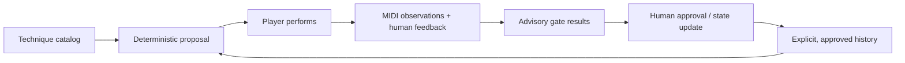

# Piano Practice System

**Status:** public reference core — initial deterministic implementation

A technique-centred, local-first piano practice system modeled on the architecture of [ryjen/guitar-practice-system](https://github.com/ryjen/guitar-practice-system). Techniques own progression; musical context makes practice meaningful; evidence and human feedback guide the next session. Neither a particular song nor a hosted AI service is required.

The initial target instrument is an **M-Audio Oxygen Pro 61**. It is a USB MIDI controller, not an acoustic piano or standalone sound generator; connect it to a software instrument if audible piano sound is needed. Hardware is optional: the lesson plans work without MIDI.

## Practice model



Technique → exercise → session realization → evidence → assessment → approved progression. Repertoire, notation, accompaniment, and hardware presets are supporting layers; none of them owns mastery.

The canonical progression vocabulary is `discovered → developing → reliable-isolation → reliable-context → maintained`, with `paused` and `retired` as separate lifecycle states. The starter CLI does **not** implement promotion: its MIDI result is one take of advisory evidence, not a declaration of mastery.

## Quick start

Requires Python 3.11+; the planner and offline assessor use only the standard library.

```sh
python3 -m unittest discover -s tests -v
python3 -m piano_practice.cli plan --date 2026-11-10
python3 -m piano_practice.cli assess examples/midi-takes/pulse-quarter-pass.json
```

To install the optional MIDI interface:

```sh
python3 -m pip install -e '.[midi]'
pianoctl ports
pianoctl capture --port 'EXACT INPUT PORT NAME' --exercise pulse-quarter --seconds 20 --bpm 60 > local/pulse-take.json
pianoctl assess local/pulse-take.json
```

Create `local/` first. Select the *note* USB MIDI port, not the DAW transport/control surface port; see [Oxygen Pro 61 setup](docs/hardware/oxygen-pro-61.md). Capture is duration-bounded; release the final note before capture finishes. The CLI records note events, velocities, and CC64 only, not audio. Pass the actual practice tempo using `--bpm` when it differs from the exercise default; this tempo is self-declared, not independently verified. No uploads occur.

## Practice rhythm

`config/practice.json` expresses a Tuesday/Thursday evening **planning preference** (America/Vancouver, 20 minutes). It does not install a calendar event, background job, or notification. Invoke `plan` with an explicit date; a 5-minute fallback is always offered.

Each proposed session has **one technique**, one bounded exercise, and one self-check. The planner rotates among three approachable foundational techniques and advances a technique only after two approved passing sessions on separate dates, with a comfortable self-report. If difficulty or tension is explicitly reported, it repeats at a reduced tempo. Absent history is unknown, not assumed novice proficiency or mastery.

Public examples are synthetic. For actual practice, copy `examples/learner-state.json` to `local/learner-state.json` and set permissions to `0600`. Only the explicit `feedback apply` command updates approved history; proposals and MIDI assessments are read-only. See [feedback approval](docs/feedback.md).

## Completing the feedback loop

```sh
mkdir -p local
cp examples/learner-state.json local/learner-state.json
chmod 600 local/learner-state.json

python3 -m piano_practice.cli feedback propose \
  --state local/learner-state.json \
  --id pulse-nov10-session1 --date 2026-11-10 --exercise pulse-quarter \
  --feedback appropriate --comfort comfortable --passed yes --bpm 60 \
  > local/proposal.json

# Review local/proposal.json before accepting it.
# Substitute the exact approval_key printed in that proposal:
python3 -m piano_practice.cli feedback apply local/proposal.json \
  --state local/learner-state.json --acknowledge 'sha256:THE_PROPOSAL_KEY'

python3 -m piano_practice.cli plan --date 2026-11-12 \
  --state local/learner-state.json
```

The approval key is a content acknowledgement, not an authentication signature.
Automatic MIDI grading never sets `--passed` for you.

## Boundaries

- MIDI can confirm note numbers, onset spacing relative to one another, relative key velocity, and note-on/off pairing. It **cannot** establish fingering, posture, muscle tension, hand identity, sound quality, or click-phase alignment.
- Oxygen Smart Chord, Smart Scale, Note Repeat, zones, octave shift, and arpeggiator may transform observable MIDI. Disable or explicitly document these modes for ordinary assessment.
- Keep personal practice logs and captured data in ignored `local/`; public catalog and fixtures must be synthetic and redistributable.
- Session proposals, feedback proposals, and MIDI assessment are read-only; only the explicit reviewed `feedback apply` step updates approved history. This does not promote canonical mastery state.
- This repository does not implement AI systems or host personal data. It follows the guitar public-core separation of concerns without copying that codebase.

See [architecture](docs/architecture.md), [hardware setup](docs/hardware/oxygen-pro-61.md), [roadmap](docs/roadmap.md), and [data contracts](contracts/v1/README.md).

**Licensing:** Public visibility does not grant a software license. Licensing remains an explicit owner decision.
