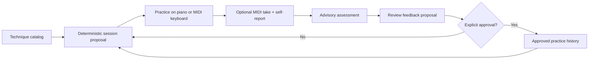

# Piano Practice System

**Status:** deterministic, local-first reference implementation. Software CI is passing; physical **M-Audio Oxygen Pro 61** qualification is outstanding.

A technique-first piano practice system modeled on [ryjen/guitar-practice-system](https://github.com/ryjen/guitar-practice-system). It answers: **What single technique should I work on next, how should I practice it, and what evidence would justify changing the plan?**

Practice is useful without a MIDI keyboard, DAW, song library, AI provider, cloud service, or account. MIDI is optional supporting evidence, not an authoritative teacher.

## Current capabilities

| Capability | Status |
| --- | --- |
| Reproducible session proposals, one technique and one self-check | Implemented |
| Nine technique areas: reading, hands together, minor/accidentals, triads, circle of fourths/fifths, four-note chords, pulse, keyboard navigation, dynamics | Implemented (two levels each) |
| Conservative rotation from approved history and explicit feedback | Implemented |
| 15-, 20-, or 30-minute sessions, with a 5-minute fallback | Implemented |
| USB MIDI port listing and bounded note/CC64 capture | Implemented, **hardware not qualified** |
| Pitch, relative onset timing, release-pairing, and relative velocity checks | Implemented, advisory |
| Human-reviewed, revision-safe feedback application | Implemented, explicit approval required |
| Context-bound feedback/v2 and separate progression gates | Implemented, explicit approval required |
| MusicXML export of original reading and minor-key exercises | Implemented |
| PianGo-compatible MusicXML export of all 18 exercises, optional annotated reference fingerings | Implemented; browser/device import unverified |
| Alfred Level 1–2 and recital metadata catalog | Implemented (references only) |
| Maintenance-due proposals from approved practice | Implemented |
| Automatic mastery promotion, synchronized metronome, synthesis, UI, calendar notifications | Not implemented |

The preferred Tuesday/Thursday evening cadence is recorded in [config/practice.json](config/practice.json) (`America/Vancouver`, 19:00, 20 minutes). **It does not create notifications or calendar events.** Invoke the planner for a specific date.

## Mental model

The system shares the guitar repository's division of responsibilities:

1. **Techniques** own learning progression, prerequisites, exercises, and gates.
2. **Sessions** realize one technique at an explicit tempo and time budget; optional repertoire and accompaniment provide musical context.
3. **Instrument adapters** observe the keyboard; they do not assert fingering, hand identity, posture, or musical intent.
4. **Evidence** combines advisory MIDI checks with explicit human observations.
5. **Assessment and planning** propose next actions, but state changes require deliberate approval.



The competency progression vocabulary is `discovered → developing → reliable-isolation → reliable-context → maintained`; `paused` and `retired` are separate lifecycle states. The planner may suggest a next-level exercise after **two distinct, approved, comfortable successful foundation sessions**. Separately, the `progression` command evaluates context-bound evidence and proposes explicitly approved competency-state transitions; MIDI scores alone never promote a technique.

## Curriculum and recital context

The [curriculum catalog](catalogs/curriculum.json) tracks goals beyond the initial timing drills:

- **Sheet reading:** decode notes and accidentals from the printed staff, not just memorize key positions.
- **Two-handed coordination:** build independence and simultaneous entries; MIDI cannot establish which hand played.
- **Circle of fourths/fifths:** navigate key relationships, key signatures, and root locations.
- **Triads:** major/minor construction, inversions, and voice leading.
- **Minor keys and accidentals:** natural vs harmonic minor, altered notes, and proper notation.
- **Four-note chords:** build and voice lead Cmaj7, Am7, and related seventh-chord structures.

Method references are **Alfred's Basic Adult Piano Course Levels One and Two**. Actual page progress, exercise names and privately owned scores stay in the local learner's notes; this public repository does not redistribute textbook material.

Three recital candidates are tracked as metadata: **Für Elise**, **Over the Rainbow** (user's Alfred Level One version), and **Jacob's Ladder**. Their relevant techniques are associated with those pieces, but neither song completion nor perfect MIDI playback substitutes for specific reading or coordination evidence. Arrangement and edition details remain unknown where not provided.

Generate original notation for selected staff-reading and minor-key exercises, then import the MusicXML into MuseScore or another compatible score editor:

```sh
mkdir -p local
python3 -m piano_practice.cli notation --exercise reading-staff-steps > local/reading-staff.musicxml
python3 -m piano_practice.cli notation --exercise reading-accidentals > local/reading-accidentals.musicxml
python3 -m piano_practice.cli notation --exercise minor-harmonic > local/minor-harmonic.musicxml
```

The generated examples are original, single-staff note-reading material. They do **not** generate or copy editions of the named recital pieces, and they do not assess hands-together performance automatically. See [curriculum and recital planning](docs/curriculum.md).

### PianGo score export and fingering references

[PianGo](https://piango.app/) can import MusicXML directly, including printed fingering. Export any original catalog exercise for its key-by-key practice interface:

```sh
mkdir -p local
python3 -m piano_practice.cli export --target piango \
  --exercise reading-staff-steps > local/reading-piango.musicxml

# Add an illustrative RH fingering reference where a curated example exists:
python3 -m piano_practice.cli export --target piango \
  --exercise minor-harmonic --fingering-reference \
  > local/minor-harmonic-piango.musicxml

# Correctly synchronized left/right hand note sequences:
python3 -m piano_practice.cli export --target piango \
  --exercise coordination-together > local/hands-together-piango.musicxml
```

Open the generated file at [PianGo](https://piango.app/) using its file chooser. Exporting is offline, read-only, and does not send practice data anywhere. **Fingering guidance is not finger-tracking or technique assessment**; the Oxygen Pro 61's physical import/playback path is still unverified. The existing `notation` command remains available. See the [PianGo integration reference and full limitations](docs/piango.md).


## Quick start — no keyboard required

Requires Python 3.11 or newer. The planner, assessor, and tests need no third-party dependencies.

```sh
git clone https://github.com/ryjen/piano-practice-system.git
cd piano-practice-system

python3 -m unittest discover -s tests -v

# Deterministic session proposal from the synthetic example history
python3 -m piano_practice.cli plan --date 2026-11-10

# Verify a synthetic MIDI take (no real keyboard needed)
python3 -m piano_practice.cli assess \
  examples/midi-takes/pulse-quarter-pass.json
```

For real practice, copy the synthetic learner state into a private working directory:

```sh
mkdir -p local
cp examples/learner-state.json local/learner-state.json
chmod 600 local/learner-state.json

python3 -m piano_practice.cli plan \
  --date 2026-11-10 --state local/learner-state.json
```

The suggested five blocks are **prepare → baseline → isolate → musical context → verify**. Follow the session instructions and self-check before deciding whether you completed the exercise. `plan` reads state but never changes it.

## M-Audio Oxygen Pro 61 setup

The Oxygen Pro 61 is a **USB MIDI controller, not a standalone sound generator**. Connect it to a software instrument or external sound module to hear piano notes; the command-line system itself does not synthesize audio.

1. Connect the keyboard and use its ordinary note-playing MIDI input, not a DAW/HUI/Mackie transport port.
2. For initial exercises, disable **Smart Chord**, **Smart Scale**, arpeggiator, Note Repeat, and layered/split zones. Confirm octave/transpose settings.
3. Install the optional MIDI capture dependencies and enumerate ports:

```sh
python3 -m pip install -e '.[midi]'
pianoctl ports
```

4. With `local/` already created, replace the exact port name and capture an exercise. Release all notes before the time limit:

```sh
pianoctl capture \
  --port 'EXACT INPUT PORT NAME' \
  --exercise pulse-quarter --seconds 20 --bpm 60 \
  > local/pulse-take.json

pianoctl assess local/pulse-take.json

# Inspect the trace without making a hardware-qualification claim
pianoctl hardware local/pulse-take.json
```

The catalog uses MIDI note numbers: **60 is middle C**, regardless of whether the DAW displays C3 or C4. The recorded tempo is **declared**, not independently measured against a click. Capture records MIDI notes and sustain CC64, not audio. [Detailed device guidance](docs/hardware/oxygen-pro-61.md) and [hardware qualification task](https://github.com/ryjen/piano-practice-system/issues/2).

**Physical qualification:** the connected remote development container currently has no `/dev/snd` access. USB-MIDI compatibility has not been established on the actual Oxygen Pro 61. Follow the [qualification checklist](docs/hardware/qualification.md) and keep issue #2 open until real-device evidence exists.

**Interpretation limit:** relative onset spacing must be within `min(120 ms, 25% of the target interval)` and alternating-dynamics exercises must rise *and* fall in MIDI velocity by the declared contrast. Neither check establishes expressive timing, acoustic loudness, fingering, or comfort.

## Record feedback and approve it

The `feedback propose` command creates a **read-only** proposal tied to the exact state, catalog, and revision. `feedback apply` is the explicit write boundary.

```sh
python3 -m piano_practice.cli feedback propose \
  --state local/learner-state.json \
  --id pulse-nov10-session1 --date 2026-11-10 \
  --exercise pulse-quarter --feedback appropriate \
  --comfort comfortable --passed yes --bpm 60 \
  --evidence-ref local/pulse-take.json \
  > local/proposal.json
```

**Review** `local/proposal.json`, including the player-reported pass result, physical comfort, date, exercise, and evidence reference. Use `--passed unknown` if you cannot confidently evaluate the self-check. MIDI assessment is never automatically substituted for the player's response.

After review, copy the *exact* `approval_key` value from the proposal:

```sh
pianoctl feedback apply local/proposal.json \
  --state local/learner-state.json \
  --acknowledge 'sha256:PASTE_EXACT_REVIEWED_KEY'

pianoctl plan --date 2026-11-12 --state local/learner-state.json
```

This apply operation rejects stale revisions, modified state/catalog content, and conflicting event IDs; exact retry is idempotent. The SHA-256 acknowledgement is **not a digital signature or user authentication**. Approvals use POSIX file locking and atomic replacement (Linux/macOS), and should not be run concurrently with editors that ignore the lock. See [feedback semantics](docs/feedback.md).

## Explicit competency and maintenance progression

New `feedback/v2` records include an explicit IANA timezone (`America/Vancouver` by default), practice context (`isolation` or `musical-context`), human-authored observation, and optional recital or Alfred method-book checkpoint references. For a real session, add these parameters to `feedback propose`:

```sh
pianoctl feedback propose \
  --state local/learner-state.json \
  --id reading-nov10-1 --date 2026-11-10 \
  --exercise reading-staff-steps --feedback appropriate \
  --comfort comfortable --passed yes --bpm 60 \
  --context isolation --observation "Read each staff note correctly" \
  --timezone America/Vancouver \
  --method-book-id alfred-basic-adult-1 \
  --method-checkpoint "Level One section 3" \
  > local/reading-feedback.json
```

Review and apply the proposal with its exact acknowledgement key, as in the previous section. Then evaluate a *separate*, non-mutating progression gate:

```sh
pianoctl progression evaluate \
  --technique reading --target developing --date 2026-11-12 \
  --state local/learner-state.json > local/reading-gate.json

# Only if gate == "pass", review and explicitly approve:
pianoctl progression apply local/reading-gate.json \
  --state local/learner-state.json \
  --acknowledge 'sha256:PASTE_EXACT_REVIEWED_GATE_KEY'

pianoctl progression due --date 2026-11-25 --state local/learner-state.json
```

The gate rules require separate approved, comfortable session dates with correct context, treat absent evidence as unknown, and reset promotion evidence after adverse feedback. A `hard` session is adverse even if the exercise self-check passed; read-only historical evaluations are allowed, but backdated promotion approvals that ignore newer feedback are rejected. An adverse report approved after a same-day transition is retained for recovery using append revisions, while same-day positive sessions do not substitute for independent post-transition practice dates. Maintained techniques become due again according to the configured interval (default 14 days), or earlier when recovery is needed. **Human approval is required for both feedback and progression**; a content digest is not a signature. See [progression contracts and gates](docs/progression.md).

## Source, evidence, and privacy

- Canonical public materials: [exercise catalog](catalogs/exercises.json), [curriculum and repertoire](catalogs/curriculum.json), [configuration](config/practice.json), [exchange contracts](contracts/v1/README.md), and [architecture](docs/architecture.md).
- Public fixtures under `examples/` are synthetic. Keep actual practice history, MIDI takes, recordings, and unreviewed proposals in **ignored `local/`**; do not commit them.
- Do not use MIDI scores to infer physical comfort, illness, finger placement, or mastery. Unknown observations remain unknown.
- There is no account system, cloud synchronization, external inference, autonomous state promotion, or implicit expenditure.
- Scheduling and repertoire expansion are [roadmap items](docs/roadmap.md); [approval/persistence work](https://github.com/ryjen/piano-practice-system/issues/3) and [real hardware qualification](https://github.com/ryjen/piano-practice-system/issues/2) are tracked separately.

## Development

```sh
python3 -m unittest discover -s tests -v
python3 -m piano_practice.cli --help
```

GitHub Actions validates the deterministic reference core and synthetic exercise fixtures. CI proves logic and contracts, **not** physical USB MIDI compatibility.

**License status:** Public repository visibility is not a license. No permission to reuse or redistribute code is implied until a license is deliberately selected.
