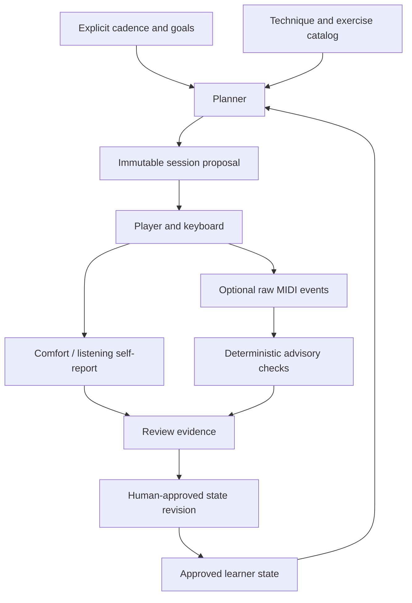

# Technique-first piano practice architecture

The primary entity is a **technique**, not a song, exercise file, device, or practice calendar event. This mirrors the guitar reference system while substituting keyboard navigation, two-hand coordination, touch/dynamics, harmonic movement, voicing, and pedaling for guitar-specific mechanics. The exercise catalog initially covers pulse, navigation, and dynamics only; the full set is a roadmap, not an implemented claim.

## Layers

1. **Technique and progress:** stable IDs, prerequisites, explicit competency stages, repeatability gates, maintenance.
2. **Exercises and musical context:** reproducible note/beat realizations, articulation, listening goal, short repetition, fallback, optional song section or accompaniment.
3. **Instrument and playback:** device profile, USB MIDI input, octave/transposition calibration, MIDI output to software synth, optional sustain and expression controllers.
4. **Evidence:** normalized time-stamped key MIDI events, human self-report, optional private recordings/repertoire refs.
5. **Advisory scheduling:** due and priority calculation from approved history, current duration, injected date/timezone. No automatic promotion.

## Contract invariants

- Same catalog, configuration, state revision, and injected local date yield the same proposal.
- `plan` and `assess` are pure with respect to canonical state: JSON in, JSON out.
- Each technique has one foundational and one next-stage exercise in the initial catalog. Two **distinct** approved passing foundation-session dates with comfort confirmed permit stage-1 recommendation; they do not prove mastery.
- Round-trip captured note-on/off events by channel+pitch. MIDI note-on with velocity zero is note-off. Reject missing/overlapping/unpaired notes and extra notes, instead of overclaiming performance accuracy.
- Inter-onset spacing is a *relative* metric; alignment to an audible click is unknown unless the clock source is synchronized. A slower planned tempo must be explicitly recorded as `bpm` in the MIDI take; the assessor otherwise uses the catalog tempo.
- The initial `alternate` velocity gate is a coarse relative contrast, not an acoustic loudness or touch assessment.
- Capture never attests to a hardware configuration. Synthetic fixtures test logical contracts, not the Oxygen USB stack.
- No scores silently update progression. No inference from missing observations. No proficiency or repertoire assumption.
- Feedback proposals bind explicit event fields to a state revision via a stable SHA-256 acknowledgement key (not authentication). An explicit apply operation is required; a POSIX sibling file lock serializes cooperating writers and an atomic replace persists the new revision.
- Unknown comfort and unknown subjective success remain unknown. An approved feedback event may influence the next recommended exercise, but is never a proof of mastery in the instrument domain.

## Future compatible extensions

Add versioned schemas for exercise realizations, multi-voice/chord notation, per-hand context observations, pedal CC64 behavior, reference MIDI/count-in timelines, score or MusicXML, and local synthesizer routing. Do not collapse hand/finger observations into MIDI-derived facts. A long-lived implementation may use SQLite as a *private projection*, but source contracts and exports remain plain files.

## Privacy and security

Practice dates, MIDI performance, recordings, and creative material can be personal. Public Git contains only generic examples. Personal history belongs under `local/` by default (ignored). MIDI source port selection must be explicit; do not enumerate or bind DAW control ports as if they were musical-note input. Capture never executes MIDI messages as scripts and never transmits data over a network.
